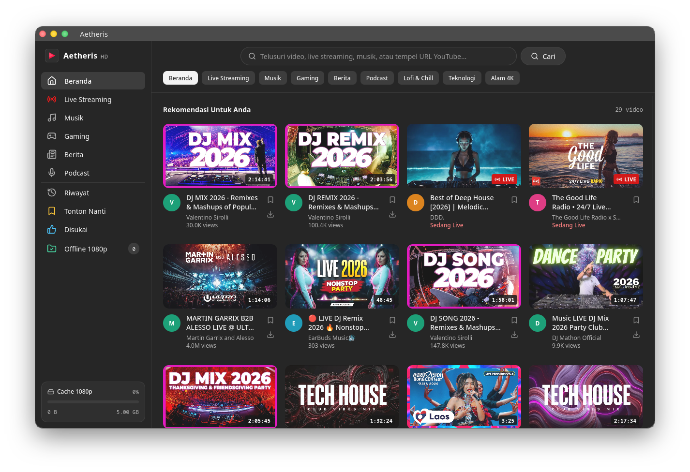

# Aetheris

Lightweight desktop video & live-streaming client built with **Tauri v2 + React + TypeScript + Rust**, using `yt-dlp`, `ffmpeg`, and an internal Axum streaming proxy for instant playback, live 1080p streams, and background 1080p WebM LRU caching.



## Features

- **Instant Playback & Live Streaming**:
  - Read-ahead 2 MiB chunk proxy (`/stream`) with `Range` support and SSRF host allowlist.
  - Real-time WebM (VP8 + Opus) transcoding for instant VOD (`/vod` with `?t=` seek support) and 1080p Live streams (`/live`) compatible with Linux WebKitGTK/GStreamer out of the box.
  - Seamless upgrade to 1080p WebM (VP9 + Opus) local disk cache (`/local`) with position resume.
- **Full Desktop Watch Experience**:
  - Category discovery chips (*Beranda*, *Live Streaming*, *Musik*, *Lofi & Chill*, *Gaming*, *Teknologi*, *Berita*, *Podcast*, *Alam 4K*) and infinite scroll recommendations.
  - 2-column Watch Mode with *Video Berikutnya*, *Putar Otomatis* toggle, Watch History (*Riwayat*), *Tonton Nanti*, *Disukai*, and *Offline 1080p* library.
  - Custom player controls in normal & fullscreen modes: Seekbar, `-10s` / `+10s` skip, volume slider, playback speed (`0.5x–2x`), Picture-in-Picture, and keyboard shortcuts (`Space`/`K`, `M`, `F`, `←`/`→`).
- **Security**:
  - No `tauri-plugin-shell` exposure; `yt-dlp` and `ffmpeg` are invoked from Rust with strict 11-character YouTube ID validation and argument arrays.
  - Local proxy restricts upstream URLs to HTTPS YouTube/GoogleVideo CDN hosts.

## Prerequisites

- **Node.js** >= 20 (`node` on `PATH` is also used by `yt-dlp --js-runtimes node`) & **npm**
- **Rust** toolchain (`cargo`, `rustc`) & `tauri-cli`
- **yt-dlp** and **ffmpeg** (with `libvpx` and `libopus`) available on `PATH`
- **Linux system libraries** (Arch): `pkgconf`, `webkit2gtk-4.1`, `gtk3`, `librsvg`, `libayatana-appindicator`

## Development, Testing & Build

```bash
npm install
npm test            # Frontend unit & component tests (Vitest)
npm run build       # TypeScript check + Vite production bundle
npm run tauri dev   # Launch desktop app in dev mode
```

Backend Rust tests:

```bash
cd src-tauri && cargo test
```

Production binary / bundle:

```bash
npm run tauri build
# Or binary only:
npm run tauri build -- --no-bundle
```
